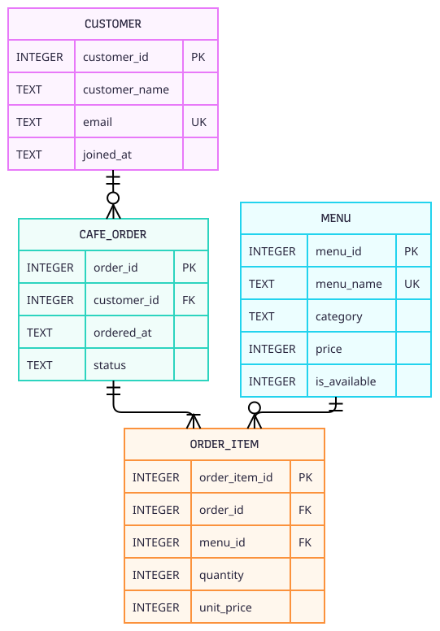

# ERD: 카페 주문 관리

```mermaid
erDiagram
    CUSTOMER ||--o{ CAFE_ORDER
    CAFE_ORDER ||--|{ ORDER_ITEM
    MENU ||--o{ ORDER_ITEM

    CUSTOMER {
      INTEGER customer_id PK
      TEXT customer_name
      TEXT email UK
      TEXT joined_at
    }
    MENU {
      INTEGER menu_id PK
      TEXT menu_name UK
      TEXT category
      INTEGER price
      INTEGER is_available
    }
    CAFE_ORDER {
      INTEGER order_id PK
      INTEGER customer_id FK
      TEXT ordered_at
      TEXT status
    }
    ORDER_ITEM {
      INTEGER order_item_id PK
      INTEGER order_id FK
      INTEGER menu_id FK
      INTEGER quantity
      INTEGER unit_price
    }
```



1:N 관계는 고객→주문, 주문→주문상세, 메뉴→주문상세의 3개입니다. `cafe_order`와 `menu`는 `order_item`을 거쳐 다대다로 연결됩니다.
